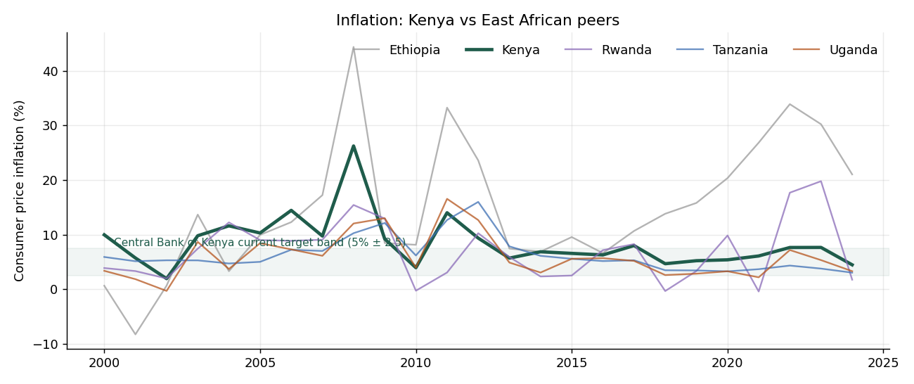
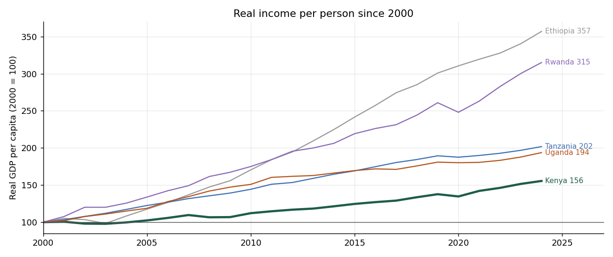
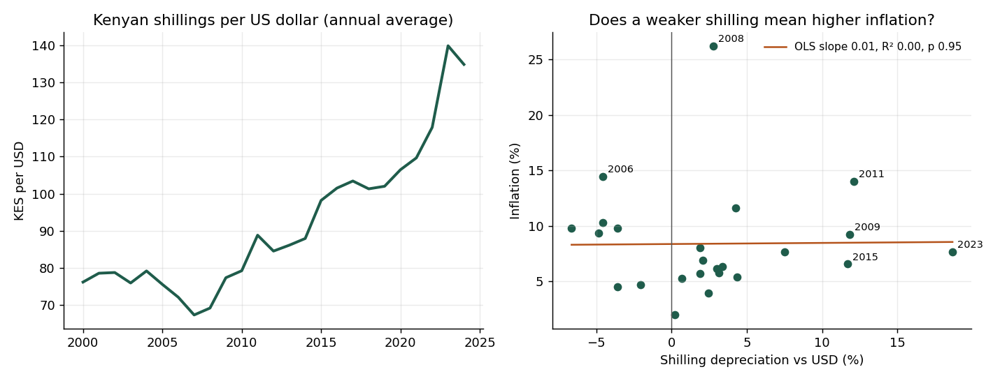
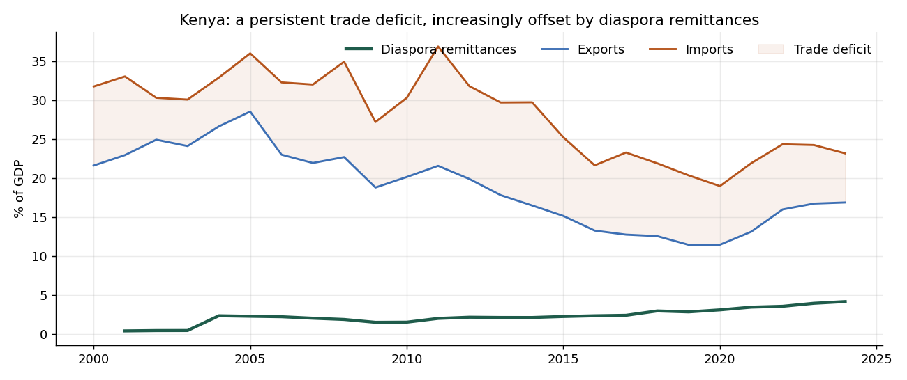

# Kenya's Economy Since 2000: How Does It Compare With Its Neighbours?

An analysis of Kenya's inflation, growth, exchange rate and external position from 2000 to 2024,
benchmarked against Uganda, Tanzania, Rwanda and Ethiopia. It uses 12 indicators from the
World Bank's World Development Indicators API (about 1,300 country-year observations).

**Questions**
1. Is Kenya's inflation high or volatile compared with its peers, and has it improved?
2. How fast has real income per person grown, compared with the rest of the region?
3. Does a weaker shilling show up as higher inflation in the annual data?
4. How has Kenya's external position changed, and how much do diaspora remittances matter?

## How to run

```bash
pip install -r requirements.txt
python src/fetch_data.py     # downloads data/worldbank_raw.csv from the World Bank API
python src/analysis.py       # writes figures/ and output/
```

## Findings

### 1. Inflation is now in the target band most years

| Country | Mean | Median | Std. dev. | Years above 10% | Peak (year) |
|---|---|---|---|---|---|
| Tanzania | 6.3% | 5.3% | 3.2 | 4 | 16.0% (2012) |
| Uganda | 6.0% | 5.2% | 4.0 | 4 | 16.6% (2011) |
| **Kenya** | **8.5%** | **7.7%** | **4.8** | **5** | **26.2% (2008)** |
| Rwanda | 7.0% | 7.2% | 5.6 | 6 | 19.8% (2023) |
| Ethiopia | 14.8% | 12.3% | 12.1 | 14 | 44.4% (2008) |

Kenya's average is pulled up by the years 2000–2012, which averaged **10.5%** and include the
2008 spike, when the post-election crisis coincided with the global food and fuel shock. From
2013 to 2024 inflation averaged **6.2%** and sat inside the Central Bank's current 2.5–7.5%
band in 9 of those 12 years.



### 2. Kenya is the richest economy in the group, and the slowest-growing per person

Real GDP per capita (constant 2015 USD) rose from **$1,195 to $1,859** between 2000 and 2024.
That is **1.9% a year**, compared with 5.4% for Ethiopia, 4.9% for Rwanda, 3.0% for Tanzania and
2.8% for Uganda. Some of this is catch-up from lower starting points. Even so, Kenya's index
(2000 = 100) reached only **156**, while every peer at least nearly doubled. Kenya's headline GDP
growth averaged 4.4%, and population growth absorbed much of it.



### 3. Annual data shows no link between the shilling and inflation

The shilling went from 76 per USD in 2000 to 135 in 2024 and lost **28% between 2021 and 2023**
alone. Even so, regressing inflation on same-year depreciation gives a slope of 0.01 with an
R² of 0.00 (p = 0.95, n = 24). With a one-year lag, the Pearson correlation is actually
*negative* (r = −0.47, p = 0.02). That result is not robust: the Spearman rank correlation is
not significant (p = 0.09), and the result depends on 2008, when inflation hit 26% straight
after the shilling *strengthened* in 2007.

**What this means:** annual averages are too coarse to measure exchange-rate pass-through,
and Kenyan inflation has been driven at least as much by food and fuel prices. Answering the
question properly would need monthly CPI broken down by component. That would be the next
step, not a conclusion to draw from this data.



### 4. Remittances now cover two-thirds of the trade deficit

- Exports fell from **28.5% of GDP (2005) to 11.4% (2020)** before recovering to 16.9% in
  2024. The trade deficit peaked at 15.3% of GDP in 2011.
- Diaspora remittances rose steadily from **2.3% of GDP in 2004 to 4.2% in 2024**, a trend of
  about +0.1 percentage points a year (p < 0.001).
- As a result, remittances offset about **13% of the trade deficit in 2011** but **66% in 2024**.



### Other observations

- The lending rate fell from 16.6% (2016) to 12.4% (2019) and then rose back to 16.6% by 2024.
  The drop matches the period of Kenya's statutory interest-rate cap (2016–2019).
- Spearman correlations across Kenya's indicators (in `output/kenya_correlations.csv`) are
  mostly weak. The strongest is that years with higher lending rates had lower GDP growth
  (ρ = −0.46). With n = 25 these are descriptive only.

## Data quality

`analysis.py` checks every ratio-to-GDP series for one-year jumps of more than 4x against both
neighbouring years. A jump that large reflects a change in how the series was compiled, not a
real economic movement. Two values were removed and logged in `output/data_quality_flags.csv`:

| Country | Series | Year | Value | Neighbour |
|---|---|---|---|---|
| Kenya | Remittances (% GDP) | 2000 | 4.23 | 0.39 (2001) |
| Ethiopia | Remittances (% GDP) | 2024 | 4.77 | 0.40 (2023) |

Kenya's 2001–2003 remittance values (about 0.4%) then jump fivefold in 2004. That looks like
the same break spread over three years, so the remittance trend above is measured from 2004.
Ethiopia's 2024 value coincides with the birr's float that July, which shrank GDP in dollar
terms, but a 12x jump in a single year still needs confirming.

Other caveats:

- World Bank unemployment figures for these countries are ILO modelled estimates, not surveys.
- Central government debt is missing for Kenya in this API, so debt is left out.
- Annual averages hide intra-year moves. The 2023 depreciation is much sharper in monthly data.

## Project layout

```
src/fetch_data.py    World Bank API download -> data/worldbank_raw.csv (tidy long format)
src/analysis.py      cleaning, series-break checks, profiles, regressions, charts
output/              summary tables (CSV), the cleaned panel and the data-quality log
figures/             charts used above
```

**Source:** World Bank, World Development Indicators (CC BY 4.0), retrieved October 2026.
